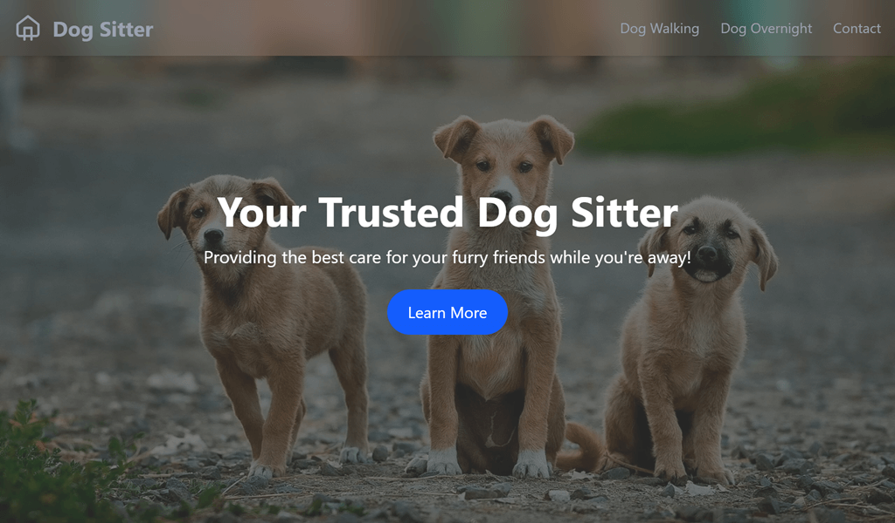

# 🐕 Dog Sitter — Modern Pet Care Website Template

A modern, responsive one-page HTML template built with **Vite** and **Tailwind CSS**, designed for dog walkers, pet sitters, and doggy daycare businesses who want to showcase their services online.

---

## 📸 Demo

**Live Preview:** [https://ahtml-dog-sitter.netlify.app/](https://ahtml-dog-sitter.netlify.app/)



---

## 🚀 Features

- 🐾 **Responsive & Mobile-First:** Smooth scrolling layout with an animated mobile hamburger menu.
- 💨 **Tailwind CSS 4.x:** Clean, utility-first styling that is easy to customize.
- 🌅 **Parallax Sections:** Background visuals for Home, Dog Walking, Overnight Care, Daycare, About, and   Contact.
- 💰 **Clear Service & Pricing Cards:** Built-in packages, daily daycare schedules, and care comparisons.
- 💌 **Pet Inquiry Contact Form:** Pre-styled form ready to connect with Formspree, Netlify Forms, or your own backend.
- ⚡ **Powered by Vite:** Fast local development server and optimized production builds.

---

## 🧱 Tech Stack

- **HTML5**
- **Tailwind CSS 4.x**
- **Vanilla JavaScript**
- **Vite**

---

## 🛠️ Setup Instructions

1. **Unzip** the downloaded template folder.

2. **Open a terminal** and navigate to the project folder:
   ```bash
   cd dog-sitter-download
   ```

3. **Install dependencies** (this generates the `node_modules` folder):
   ```bash
   npm install
   ```

4. **Start the development server** (opens at `http://localhost:5173`):
   ```bash
   npm run dev
   ```

5. **Build for production** (generates an optimized `dist/` folder):
   ```bash
   npm run build
   ```

---

## 📁 Folder Structure

```text
Dog-Sitter-Template/
├── index.html              # Main landing page
├── package.json            # Project dependencies and scripts
├── vite.config.js          # Vite configuration
├── public/
│   └── assets/             # Images and media files
└── src/
    ├── main.js             # JavaScript interactions (mobile menu, smooth scroll)
    └── style.css           # Tailwind CSS imports and custom styles
```

---

## 💡 Customization Notes

1. **Contact Form Setup:** The contact form uses a placeholder [Formspree](https://formspree.io) endpoint (`action="https://formspree.iof/your-form-id"`). Replace `your-form-id` with your own Formspree ID, or connect it to Netlify Forms or a custom backend.

2. **Placeholder Content:** All text, rates, and photography are for demonstration purposes only. Feel free to swap in your own branding, pricing, and images.

---

## 📄 License

This template is provided under a **Commercial Use License**.
- ✅ **Allowed:** Use and modify for unlimited personal or client projects.
- ❌ **Not Allowed:** Resale, redistribution, or inclusion in other template bundles or marketplaces.

---

## 👍 Credits

- **Design & Development:** AH for simpleDesigns
- **Placeholder Photography:** [Unsplash](https://unsplash.com/)
- **Icons:** [Heroicons](https://heroicons.com) / [Font Awesome](https://fontawesome.com/) & [Boxicons](https://boxicons.com/)

Enjoy building your next project! 🐕
